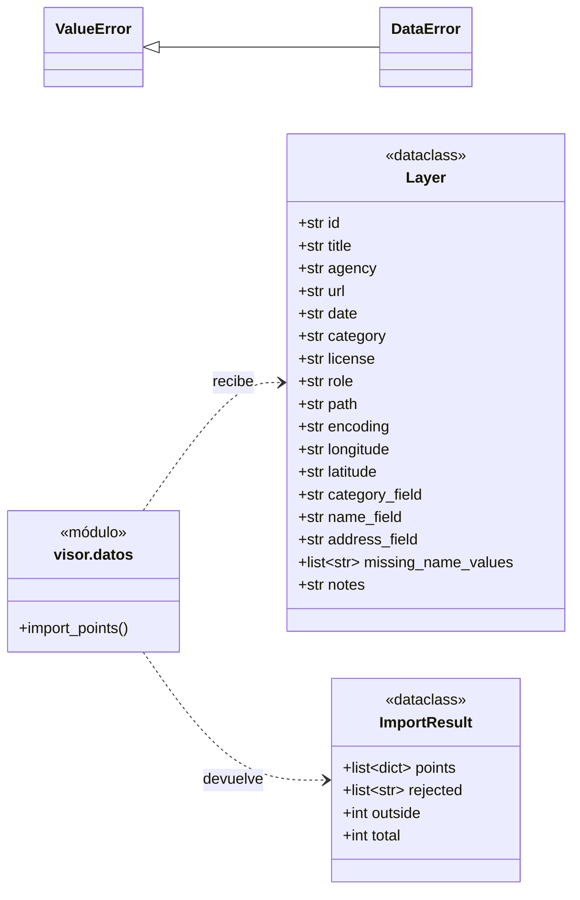
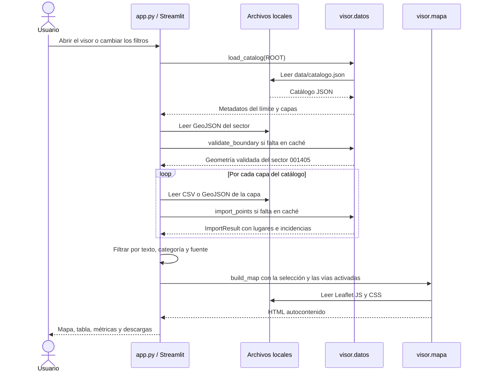
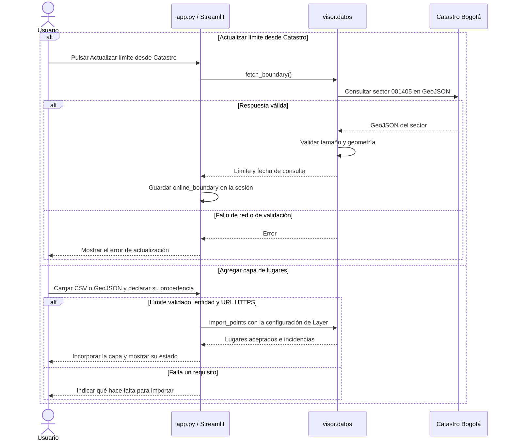
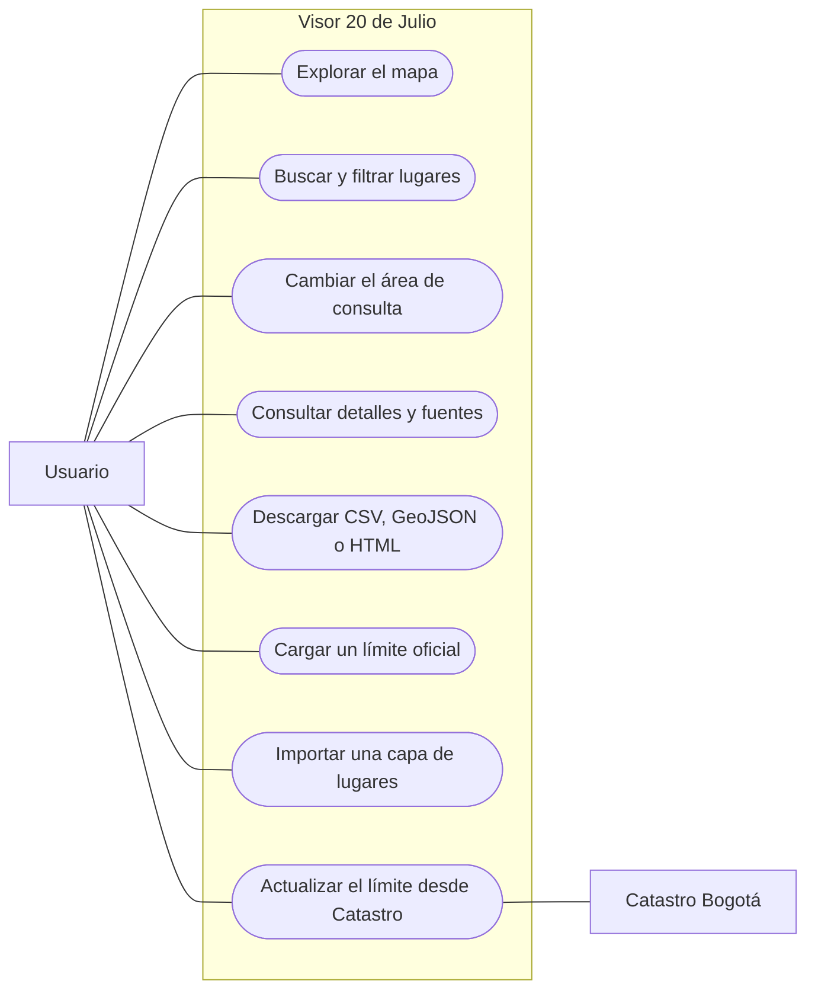

# Ingeniería inversa del visor 20 de Julio

El visor es una aplicación Streamlit que muestra comercios y sitios de interés del sector catastral 001405, en San Cristóbal, Bogotá. Los diagramas se basan en el código del commit `2d2efe3`.

| Componente | Responsabilidad |
| --- | --- |
| [`app.py`](../app.py) | Coordina la sesión, las cargas, los filtros, las métricas y las descargas. |
| [`visor/datos.py`](../visor/datos.py) | Carga el catálogo, valida el límite y procesa los archivos con Shapely y pyproj. |
| [`visor/mapa.py`](../visor/mapa.py) | Genera con Folium el HTML del mapa e incrusta Leaflet. |
| [`data/catalogo.json`](../data/catalogo.json) | Describe las capas locales, su procedencia y los campos que deben interpretarse. |

## Diagrama de clases

`Layer` e `ImportResult` son clases de datos de Python. `import_points()` recibe una instancia de `Layer` y devuelve una de `ImportResult`. Los lugares aceptados son diccionarios en `ImportResult.points`. La interfaz y el renderizado se implementan con módulos y funciones.

El módulo `visor.datos` aparece para identificar la función que conecta los dos modelos. [Declaración de modelos](../visor/datos.py#L36) · [Función de importación](../visor/datos.py#L174)

## Diagramas de secuencia

### Abrir el visor y consultar lugares

Flujo principal con el catálogo y el límite locales. Streamlit reejecuta el guion ante cambios en los controles y reutiliza los resultados de validación e importación cuando coinciden las entradas de caché.

El radio es de 300 m cuando se activa la cercanía y de 0 m cuando se consulta solo el sector. Las vías del catálogo se importan con radio de 0 m y se usan como contexto cartográfico. [Consulta y filtros](../app.py#L44) · [Área de cobertura e importación](../visor/datos.py#L165) · [Renderizado del mapa](../visor/mapa.py#L14)

### Actualizar el límite o importar una capa

La actualización consulta Catastro y guarda el resultado validado en la sesión. Al resolver el límite, el visor da prioridad al archivo aportado por el usuario, luego al límite actualizado de la sesión y por último al archivo del catálogo.

La comprobación de procedencia en la interfaz exige una entidad y un enlace que empiece por `https://`. La importación procesa el archivo cargado en la sesión. [Controles de carga y actualización](../app.py#L44) · [Gestión de capas aportadas](../app.py#L94) · [Consulta de Catastro](../visor/datos.py#L156)

## Diagrama de casos de uso

El actor principal es quien consulta el visor. Catastro Bogotá participa como sistema externo al actualizar el límite. Las líneas representan participación en un caso de uso.

| Caso de uso | Comportamiento observado |
| --- | --- |
| Explorar y acotar la consulta | El usuario navega el mapa, muestra u oculta capas y aplica filtros por nombre o dirección, categoría y fuente. |
| Cambiar el área de consulta | Puede incluir sitios hasta 300 m fuera del sector. La tabla distingue esos registros de los que intersectan el sector. |
| Consultar detalles y fuentes | Las fichas muestran el nombre, la ubicación, la dirección y la procedencia disponibles. El panel de fuentes muestra además los conteos de registros e incidencias. |
| Descargar resultados | CSV y GeoJSON usan los lugares que pasan los filtros. HTML conserva el mapa visible y las vías cuando se muestran. Las capas con registros inválidos también ofrecen un informe de incidencias. |
| Cargar o actualizar el límite | Se valida el código 001405 y una geometría poligonal. El límite válido habilita el cruce espacial. |
| Importar una capa | Se acepta GeoJSON o CSV. El visor clasifica los lugares con el límite validado e informa los registros que no pudo procesar. |
